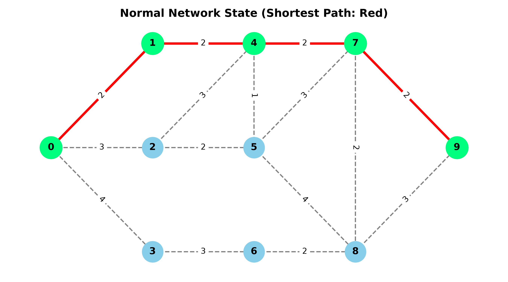
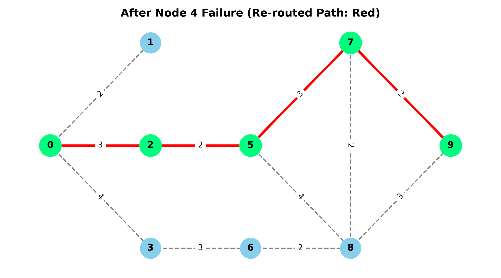

# Decentralized Node Failure Tolerance and Bandwidth-Efficient Re-Routing in Mesh Network Architecture

This repository contains the simulation environment for a 10-node decentralized mesh network. It evaluates network performance under node failures and measures re-routing convergence latency using Dijkstra's Shortest Path Algorithm.

## 📌 Project Features
- **10-Node Mesh Topology**: Multi-hop layout simulating real IoT/ESP32 hardware nodes.
- **Dynamic Shortest Path Routing**: Uses Dijkstra's algorithm to compute minimum latency routes.
- **Fault Tolerance**: Automatic detection of failed nodes and fast path re-convergence.
- **Automated Visualization**: Generates network topology graphs for before and after failure states.
- **Data Export**: Saves detailed metrics to `simulation_results.csv`.

## 📊 Network Topology & Re-Routing Visualizations

| Normal State (Initial Shortest Path) | Re-Routed State (After Node 4 Failure) |
| :---: | :---: |
|  |  |

## 🚀 How to Run

1. Clone the repository:
   ```bash
   git clone [https://github.com/csrefat/mesh-network-rerouting-simulation.git](https://github.com/csrefat/mesh-network-rerouting-simulation.git)
   cd mesh-network-rerouting-simulation
